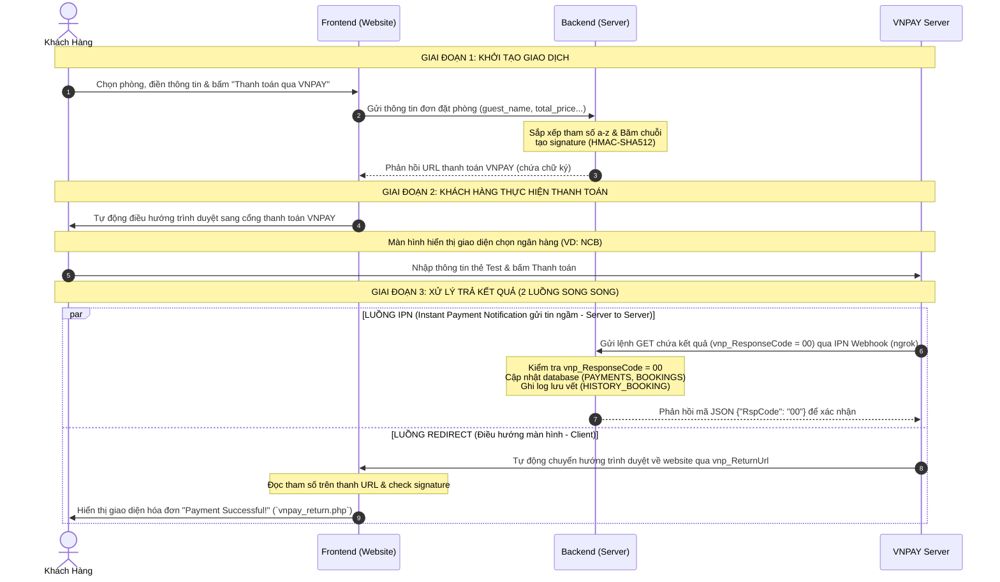

# Ocean Haven Hotel — Hệ thống Đặt phòng Khách sạn

Đây là dự án Website Đặt phòng Khách sạn (Ocean Haven Hotel), cung cấp đầy đủ các tính năng cho phía người dùng cuối (tìm kiếm, lọc, đặt phòng, thanh toán trực tuyến qua VNPAY) và trang Quản trị (Dashboard thống kê, kiểm tra nhận phòng).

Dự án được xây dựng dựa trên kiến trúc **PHP thuần (Vanilla PHP) kết hợp MySQL** ở phía Backend và **Vanilla JavaScript, CSS Component-based** ở phía Frontend.

---

## 📌 MỤC LỤC
1. [Cấu trúc Thư mục Tổng quan](#1-cấu-trúc-thư-mục-tổng-quan)
2. [Chi tiết Chức năng & Mối liên kết các File](#2-chi-tiết-chức-năng--mối-liên-kết-các-file)
3. [Luồng Kiến trúc Frontend (JS & CSS Modular)](#3-luồng-kiến-trúc-frontend-js--css-modular)
4. [Luồng Xử lý Thanh toán (VNPAY)](#4-luồng-xử-lý-thanh-toán-vnpay)
5. [Cấu trúc Database](#5-cấu-trúc-database)
6. [Giải thích Các Tính năng Chính](#6-giải-thích-các-tính-năng-chính-key-features-explanation)
7. [Thách thức và Giải pháp](#7-thách-thức-và-giải-pháp-challenges--solutions)
8. [Tài liệu Tích hợp Thanh toán VNPAY (Sandbox)](#8-tài-liệu-tích-hợp-thanh-toán-vnpay-sandbox)

---

## 1. CẤU TRÚC THƯ MỤC TỔNG QUAN

```text
final_assignment/
├── admin/                  # Khu vực quản trị (Chỉ dành cho tài khoản Admin)
├── api/                    # Chứa các endpoint API xử lý logic Backend
├── assets/                 # Các tài nguyên tĩnh (CSS, JS, Images tĩnh)
│   ├── css/                # Đã chia nhỏ thành components/ và pages/
│   └── js/                 # Đã chia module rõ ràng giữa Template và Controller
├── auth/                   # Xử lý phiên làm việc, Đăng nhập, Đăng ký
├── config/                 # Các file cấu hình Database và API bên thứ 3
├── template/               # Giao diện dùng chung (Header, Footer, Navbar...)
├── home.php                # Trang chủ khách sạn
├── rooms.php               # Trang danh sách toàn bộ phòng (có bộ lọc)
├── detail.php              # Trang chi tiết 1 phòng cụ thể
└── vnpay_return.php        # Trang hiển thị kết quả sau thanh toán VNPAY
```

---

## 2. CHI TIẾT CHỨC NĂNG & MỐI LIÊN KẾT CÁC FILE

### Giao diện Người dùng (Frontend PHP Pages)
Các file này đại diện cho các trang mà người dùng truy cập trực tiếp. Tất cả đều tuân theo nguyên tắc: Include `header/index.php` ở trên cùng và `template/footer.php` ở dưới cùng.
- **`home.php`**: Hiển thị trang chủ với Hero section và danh sách phòng nổi bật.
- **`rooms.php`**: Trang "Tất cả phòng", cung cấp giao diện sidebar bộ lọc (giá, sức chứa, tiện ích) và thanh tìm kiếm từ khóa.
- **`detail.php`**: Trang chi tiết phòng. Hiển thị thư viện ảnh (gallery), danh sách tiện ích và widget đặt phòng (Sticky Booking Widget).

### API Endpoints (`/api/`)
Đóng vai trò là cầu nối Backend cung cấp dữ liệu dạng JSON cho Frontend JavaScript:
- **`create_booking.php`**: Xử lý tạo đơn hàng mới, lưu vào CSDL (`Pending`), tạo link thanh toán VNPAY và trả về Frontend.
- **`vnpay_ipn.php`**: Xử lý callback ngầm (Server-to-Server) từ cổng thanh toán. Cập nhật trạng thái (`Confirmed` hoặc `Cancelled`) cho DB dựa vào chữ ký điện tử.
- **`get_profile.php` / `update_profile.php`**: Lấy và cập nhật thông tin cá nhân của User hiện tại.
- **`get_bookings.php` / `cancel_booking.php`**: Lấy danh sách phòng đã đặt của User và xử lý yêu cầu hủy phòng.

### Khu vực Quản trị (`/admin/`)
- **`index.php`**: Trang tổng quan cho lễ tân/quản trị viên. 
  - Thống kê tự động (Số lượng đơn, doanh thu, phòng khả dụng).
  - Khung tìm kiếm đơn đặt phòng theo số điện thoại (Hỗ trợ Check-in).
  - Bảng danh sách Check-in sắp xếp từ mới nhất tới cũ nhất.

### Giao diện dùng chung (`/template/`)
- **`header/index.php`**: Khai báo thẻ `<head>`, SEO meta tags, load CSS toàn cục (global, navbar, footer) và load động các CSS riêng của từng trang qua mảng `$pageStyles`. Include `navbar.php`, `login-modal.php`, `register-modal.php`.
- **`footer.php`**: Hiển thị chân trang và quản lý việc chèn thẻ `<script>`. Hỗ trợ load động các JS modules theo thứ tự (Templates trước, Controllers sau) thông qua mảng `$pageScripts`.

---

## 3. LUỒNG KIẾN TRÚC FRONTEND (JS & CSS MODULAR)

Hệ thống Frontend đã được chia nhỏ hoàn toàn (Modularized) để tối ưu hiệu suất và dễ bảo trì:

### Kiến trúc JavaScript (`assets/js/`)
Mọi Component đều được tách thành 2 file riêng biệt:
1. **Tệp Templates (`*.templates.js`)**: Sinh ra chuẩn chuỗi HTML. Không thao tác DOM, không gán sự kiện.
2. **Tệp Controllers (`*.js`)**: Gọi API (thông qua `global.js`), gán dữ liệu vào Templates và chèn vào DOM, bắt sự kiện click/submit.

**Các modules nổi bật:**
- **`profile/`**: Quản lý Modal hồ sơ cá nhân và Upload Avatar (lưu tạm qua localStorage `ocean_haven_avatar_[email]`).
- **`booking/`**: Quản lý đa bước (Multi-step) modal đặt phòng (Tính toán giá, chọn cổng thanh toán).
- **`rooms/` & `detail/`**: Quản lý logic bộ lọc phòng phức tạp và gallery xem ảnh chi tiết.
- **`global.js`**: Cung cấp `window.HotelDb` làm lớp giao tiếp trung tâm (API Layer) cho toàn bộ ứng dụng.

### Kiến trúc CSS (`assets/css/`)
File CSS nguyên khối đã được tách:
- **`global.css`**: Chứa CSS Variables, reset layout, typography và các util/button cơ bản.
- **`components/`**: Các file CSS cho từng thành phần giao diện nhỏ (`navbar.css`, `footer.css`, `search-bar.css`, `room-card.css`, `modals.css`).
- **`pages/`**: Các layout lớn dành riêng cho một trang cụ thể (`home.css`, `rooms.css`, `detail.css`).

> **Cơ chế Load CSS/JS Động:** PHP cấu hình mảng `$pageStyles` và `$pageScripts` trong mỗi trang (ví dụ `rooms.php`) để chỉ tải xuống trình duyệt đúng những CSS và JS mà trang đó cần.

---

## 4. LUỒNG XỬ LÝ THANH TOÁN (VNPAY)

Hệ thống được thiết kế chặt chẽ với **2 luồng song song** khi nhận phản hồi từ cổng thanh toán:

1. **Luồng Giao diện (Client Redirect): `vnpay_return.php`**
   - Trình duyệt của khách hàng bị điều hướng về trang này sau khi quét mã thanh toán.
   - Kiểm tra chữ ký (Hash HMAC), hiển thị thẻ báo cáo hóa đơn Thành công/Thất bại.
   - **Tuyệt đối không** dùng trang này làm nguồn đáng tin cậy để cập nhật Database.

2. **Luồng Cập nhật ngầm (IPN Server-to-Server): `api/vnpay_ipn.php`**
   - Cổng thanh toán (VNPAY) gọi ngầm (POST/GET Request) tới server của chúng ta.
   - Kiểm tra chữ ký hợp lệ -> **Trực tiếp cập nhật bảng BOOKINGS và PAYMENTS** trong Database.
   - Luôn phản hồi HTTP 200 (hoặc mã JSON `{RspCode: 00}`) để VNPAY biết hệ thống đã nhận IPN.

---

## 5. CẤU TRÚC DATABASE

- **`USERS`**: Lưu thông tin đăng nhập, mật khẩu mã hóa (Bcrypt) và quyền (`role: admin | user`).
- **`ROOMS`**: Danh mục phòng, sức chứa, giá tiền cơ bản và mảng tiện nghi lưu dạng JSON.
- **`BOOKINGS`**: Dữ liệu hóa đơn đặt phòng. Quan hệ 1-nhiều với USERS và ROOMS. Trạng thái (`Pending`, `Confirmed`, `Cancelled`).
- **`PAYMENTS`**: Giao dịch thanh toán cụ thể. Có lưu `vnpay_order_id` / `transaction_id` để đối soát với cổng thanh toán. Liên kết chặt với BOOKINGS.
- **`HISTORY_BOOKING`**: Bảng ghi log các thao tác (tạo đơn, thanh toán thành công, hủy phòng) dùng để truy vết lỗi.

## 6. GIẢI THÍCH CÁC TÍNH NĂNG CHÍNH (KEY FEATURES EXPLANATION)

### 6.1. Thuật toán xử lý Đặt phòng và Lọc theo ngày (Date Search & Overlapping Logic)
Một trong những tính năng phức tạp nhất của hệ thống đặt phòng là **hiển thị phòng trống theo ngày** và **tránh trùng lặp ngày** (double-booking).
Khi một người dùng đặt phòng vào một khoảng thời gian, phòng đó sẽ "biến mất" (không hiển thị) trong những ngày đó ở mục tìm kiếm, nhưng vẫn hoàn toàn khả dụng để đặt vào các ngày khác (không bị trùng).

**Ví dụ logic thực tế**:
- Khách hàng A đặt Phòng 001 từ ngày `01/10` đến `05/10`.
- Nếu Khách hàng B tìm kiếm phòng từ ngày `03/10` đến `06/10` (hoặc `01/10` đến `02/10`), Phòng 001 sẽ **không hiển thị** vì khoảng thời gian tìm kiếm giao nhau (overlap) với lịch đã đặt của khách A.
- Tuy nhiên, nếu Khách hàng B tìm kiếm từ ngày `05/10` đến `10/10`, Phòng 001 **vẫn sẽ hiển thị bình thường**. Khách A check-out vào ngày 05 và khách B check-in vào ngày 05 là hợp lệ, hệ thống không tính đây là trùng lịch.

**Triển khai kỹ thuật (Implementation Details):**
Bài toán này được giải quyết bằng thuật toán giao nhau tập hợp thời gian (Intersection) thông qua SQL, được bảo vệ nghiêm ngặt ở 2 chốt chặn:

1. **Chốt chặn 1: Tính năng Date Search (Hiển thị/Ẩn phòng trên giao diện)**
   Được implement tại file `api/get_rooms.php` (Từ **dòng 65 đến 72**).
   Khi người dùng chọn ngày trên bộ lọc tìm kiếm, API sẽ loại bỏ (NOT IN) những phòng đang có đơn đặt phòng cắt ngang (overlap) với thời gian mà người dùng đang tìm kiếm:
   ```sql
   AND r.id NOT IN (
       SELECT b.room_id FROM BOOKINGS b
       WHERE b.status != 'Cancelled'
         AND b.check_in < '$check_out'
         AND b.check_out > '$check_in'
   )
   ```
   *Giải thích logic*: Điều kiện `b.check_in < $check_out AND b.check_out > $check_in` chính là công thức toán học chuẩn để kiểm tra 2 khoảng thời gian có cắt nhau hay không. Nhờ câu query này, phòng sẽ chỉ tự động "biến mất" vào đúng những ngày bị overlap.

2. **Chốt chặn 2: Ngăn chặn Đặt trùng (Double-booking Prevention)**
   Được implement tại file `api/create_booking.php` (Từ **dòng 61 đến 72**).
   Đề phòng trường hợp 2 user cùng truy cập vào chi tiết 1 phòng lúc đang trống (chưa reload trang), nhưng 1 người bấm thanh toán trước. Lúc này chốt chặn 2 sẽ hoạt động:
   ```sql
   SELECT COUNT(*) AS booked_count FROM BOOKINGS 
   WHERE room_id = '$room_id' 
     AND status != 'Cancelled' 
     AND check_in < '$check_out' 
     AND check_out > '$check_in'
   ```
   Nếu `booked_count > 0`, API lập tức trả về lỗi: *"Selected room is already booked for these dates."* và hủy bỏ quá trình tạo hóa đơn.

### 6.2. Cơ chế giữ chỗ (Booking Hold)
Khi khách hàng bấm "Thanh toán", họ sẽ được chuyển hướng sang VNPAY. Trong lúc này, phòng chưa được thanh toán thành công nhưng cần được **giữ chỗ** để tránh người khác đặt cùng lúc.
- Hệ thống lưu trạng thái đơn hàng là `Pending` và lưu thời điểm hết hạn `hold_expires_at = CURRENT_TIME + 15 phút`.
- Nếu quá 15 phút mà IPN từ VNPAY không phản hồi (do khách hàng hủy hoặc tắt trình duyệt), đơn sẽ tự động bị hủy (thông qua Cronjob hoặc logic quét trước khi load phòng).

---

## 7. THÁCH THỨC VÀ GIẢI PHÁP (CHALLENGES & SOLUTIONS)

### 7.1. File CSS/JS quá lớn (Monolithic Code)
- **Vấn đề**: Toàn bộ CSS (2000 dòng) và JS bị dồn vào 1-2 file, gây khó khăn cho việc bảo trì, dễ bị xung đột CSS (conflict) và làm chậm tốc độ tải trang ban đầu (render-blocking).
- **Giải pháp**: Xây dựng kiến trúc Modular. Tách CSS thành `global`, `components/`, và `pages/`. Tách JS thành các file `Templates` (chỉ xuất HTML) và `Controllers` (xử lý logic). Sử dụng mảng PHP `$pageStyles` và `$pageScripts` để trình duyệt chỉ cần tải đúng file cần thiết cho từng trang cụ thể.

### 7.2. Đồng bộ kết quả thanh toán (IPN vs Redirect)
- **Vấn đề**: Sau khi thanh toán xong, làm sao biết được thanh toán thành công hay thất bại một cách chính xác nhất mà không phụ thuộc vào trình duyệt của người dùng (nếu người dùng tắt trình duyệt thì sao)?
- **Giải pháp**: Tách luồng xử lý làm hai. 
  1. Dùng **Trang Redirect** (`vnpay_return.php`) chỉ để làm nhiệm vụ hiển thị giao diện "Cảm ơn bạn đã thanh toán".
  2. Dùng **IPN Callback** (`api/vnpay_ipn.php`) làm kênh liên lạc ngầm giữa Server VNPAY và Server của chúng ta. Khi thanh toán thành công, VNPAY tự động ping vào IPN này, xác thực chữ ký (SHA512) và ghi nhận vào Database một cách an toàn kể cả khi người dùng mất kết nối Internet lúc chuyển trang.

---
---

## 8. TÀI LIỆU TÍCH HỢP THANH TOÁN VNPAY (SANDBOX)
*(Tài liệu chi tiết về VNPAY Integration)*

> **Phương thức:** Chuyển hướng thanh toán qua VNPAY Gateway
> **Database:** MySQL (schema đính kèm bên trên)
> **Mã hóa:** HMAC-SHA512

### SƠ ĐỒ TỔNG QUAN LUỒNG CHẠY HỆ THỐNG


### ⚠️ Bắt buộc: Set up ngrok cho URL IPN

VNPAY Sandbox cần gọi API xác nhận (IPN) vào hệ thống của bạn. Nếu bạn chạy trên `localhost`, VNPAY không thể kết nối được. Do đó, bạn cần sử dụng ngrok để mở port.

1. Chạy XAMPP server.
2. Chạy ngrok: `ngrok http 80` -> Lấy URL dạng `https://abc123.ngrok-free.app`.
3. Đăng nhập vào trang quản trị VNPAY Sandbox (hoặc sử dụng file cấu hình) và khai báo URL IPN là: 
`"https://abc123.ngrok-free.app/final_assigment/api/vnpay_ipn.php"`

*(Lưu ý: `vnp_ReturnUrl` vẫn có thể giữ nguyên là `localhost` trong file `vnpay-config.php` vì trình duyệt của bạn tự động chuyển hướng).*

### VNPAY Sandbox Test Credentials
Sử dụng thẻ giả lập sau để test thanh toán thành công qua ngân hàng NCB tại cổng Sandbox:

| Trường dữ liệu | Giá trị Test |
|-------|-------|
| Ngân hàng | `NCB` |
| Số thẻ | `9704198526191432198` |
| Tên in trên thẻ | `NGUYEN VAN A` |
| Ngày phát hành | `07/15` |
| Mật khẩu OTP | `123456` |
