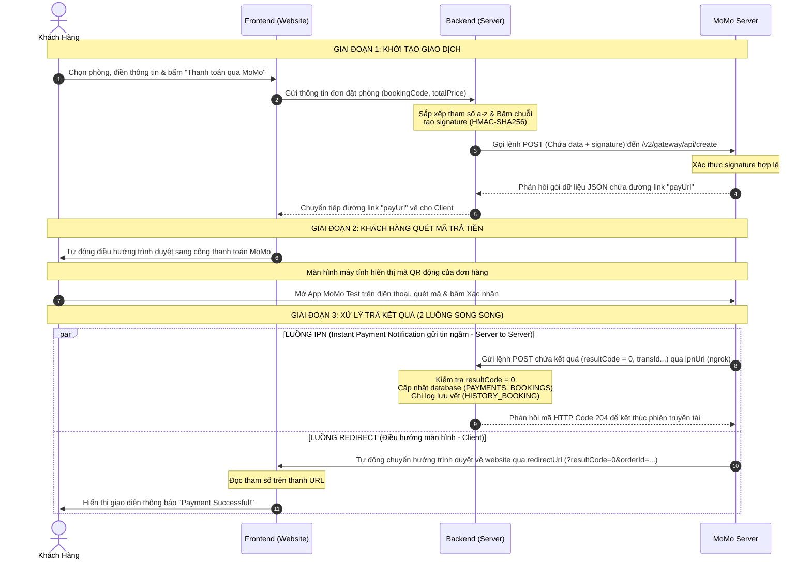

# final-assignment

# 📑 TÀI LIỆU TÍCH HỢP THANH TOÁN MOMO (SANDBOX) — HỆ THỐNG ĐẶT PHÒNG KHÁCH SẠN

> **Phương thức:** `captureWallet`
> **Database:** MySQL (schema đính kèm bên dưới)
> **Stack tham khảo:** Node.js + Express (áp dụng tương tự cho bất kỳ backend nào — Java, PHP, .NET...)

---

## 📌 MỤC LỤC

1. [Sơ đồ tổng quan luồng](#1-sơ-đồ-tổng-quan-luồng)
2. [Cấu trúc Database liên quan](#2-cấu-trúc-database-liên-quan)
3. [Chuẩn bị môi trường & thông tin cấu hình](#3-chuẩn-bị-môi-trường--thông-tin-cấu-hình)
4. [Implementation chi tiết từng bước](#4-implementation-chi-tiết-từng-bước)
5. [Bảng tổng hợp Docs tham khảo](#5-bảng-tổng-hợp-docs-tham-khảo)
6. [Checklist kiểm thử](#6-checklist-kiểm-thử)

---

## SƠ ĐỒ TỔNG QUAN LUỒNG CHẠY HỆ THỐNG


---

## 2. CẤU TRÚC DATABASE LIÊN QUAN

```sql
CREATE TABLE BOOKINGS (
  id VARCHAR(36) PRIMARY KEY,
  booking_code VARCHAR(50) UNIQUE,
  user_id VARCHAR(36),
  room_id VARCHAR(36),
  check_in DATE,
  check_out DATE,
  guest_count INT,
  guest_name VARCHAR(255),
  guest_email VARCHAR(255),
  guest_phone VARCHAR(20),
  special_requests TEXT,
  total_price DECIMAL(15,2),
  status ENUM('Pending', 'Confirmed', 'Completed', 'Cancelled') DEFAULT 'Pending',
  create_at TIMESTAMP DEFAULT CURRENT_TIMESTAMP,
  FOREIGN KEY (user_id) REFERENCES USERS(id) ON DELETE SET NULL,
  FOREIGN KEY (room_id) REFERENCES ROOMS(id) ON DELETE SET NULL
);

CREATE TABLE PAYMENTS (
  id VARCHAR(36) PRIMARY KEY,
  booking_id VARCHAR(36) UNIQUE,
  payment_method VARCHAR(50),
  transaction_id VARCHAR(255) UNIQUE,
  momo_order_id VARCHAR(150) UNIQUE;  -- Cột này để tra cứu chính xác khi MoMo gửi IPN về (vì orderId gửi lên MoMo sẽ khác booking_code, xem lý do ở mục 3)
  amount DECIMAL(15,2),
  status ENUM('Pending', 'Completed', 'Failed', 'Refunded') DEFAULT 'Pending',
  paid_at TIMESTAMP NULL DEFAULT NULL,
  FOREIGN KEY (booking_id) REFERENCES BOOKINGS(id) ON DELETE CASCADE
);

CREATE TABLE HISTORY_BOOKING (
  id VARCHAR(36) PRIMARY KEY,
  booking_id VARCHAR(36),
  action VARCHAR(100),
  note TEXT,
  created_at TIMESTAMP DEFAULT CURRENT_TIMESTAMP,
  FOREIGN KEY (booking_id) REFERENCES BOOKINGS(id) ON DELETE CASCADE
);
```

---

## MoMo Payment Flow — Full Explanation
There are 5 files involved. Here's the exact order they activate:

📁 File Activation Order
1. momo-config.php        ← loaded by everything (config only)
2. booking-modal.js       ← user triggers payment
3. create_booking.php     ← creates booking + gets MoMo link
4. momo_ipn.php           ← MoMo confirms payment (server→server)
5. momo_return.php        ← user lands here after paying
Step-by-step breakdown
1. User clicks "Thanh toán với MoMo" → 

### booking-modal.js
1. runs in the browser

```
User fills form → clicks button
→ JS collects: room_id, check_in, check_out, guest_name, email, phone
→ JS sends POST fetch() to → api/create_booking.php
```

2. create_booking.php runs on your PHP server → 

### api/create_booking.php

    1. Validates dates, room availability
    2. Calculates price (nights × price + 10% tax)
    3. Inserts BOOKING row  → status = "Pending"
    4. Inserts PAYMENT row  → status = "Pending"
    5. Loads momo-config.php (credentials, URLs)
    6. Builds HMAC-SHA256 signature
    7. Sends POST request → MoMo sandbox API
    8. MoMo returns { payUrl: "https://test-payment.momo.vn/..." }
    9. Returns { success: true, payUrl } → back to JS

3. booking-modal.js receives payUrl

### data.payUrl received
```
→ window.location.href = data.payUrl
→ Browser redirects user to MoMo's payment page
```

4. User pays on MoMo's page MoMo fires two responses simultaneously:
```
┌─────────────────────────────────┐   ┌──────────────────────────────────┐
│  IPN (server → server)          │   │  Redirect (browser → your site)  │
│  MoMo calls your ngrok URL      │   │  MoMo sends user back to you     │
│  → api/momo_ipn.php             │   │  → momo_return.php               │
└─────────────────────────────────┘   └──────────────────────────────────┘
```
5. momo_ipn.php — the authoritative DB update → 

api/momo_ipn.php

MoMo sends JSON payload (in background, not visible to user):
{
  orderId, resultCode, transId, amount, signature...
}
    1. Verifies HMAC-SHA256 signature  ← security check
    2. Finds PAYMENT row by momo_order_id
    3. Checks idempotency (already processed? → skip)
    4. If resultCode === 0 (success):
        BOOKINGS.status  → "Confirmed"
        PAYMENTS.status  → "Completed"
        PAYMENTS.transaction_id → MoMo's transId
        HISTORY_BOOKING  → log "PAYMENT_CONFIRMED"
    5. If resultCode ≠ 0 (failed/cancelled):
        BOOKINGS.status  → "Cancelled"
        PAYMENTS.status  → "Failed"
    6. Always returns HTTP 200 (MoMo requires this)
6. momo_return.php — what the user sees → 

    momo_return.php

    MoMo redirects browser with query params:
    ?orderId=...&resultCode=0&transId=...&signature=...
    1. Verifies HMAC-SHA256 signature
    2. Looks up BOOKING + PAYMENT from DB by orderId
    3. resultCode === 0 → shows ✅ success card with booking details
    4. resultCode ≠ 0   → shows ❌ failure card with error message
    Why IPN + Return page both exist?
    IPN (momo_ipn.php)	Return page (momo_return.php)
    Who calls it	MoMo's servers	User's browser
    Purpose	Update the database	Show UI to user
    Reliability	✅ Always fires, even if user closes browser	❌ Fails if user closes tab
    Trusted for DB	✅ Yes	⚠️ No — display only
    IMPORTANT

    The IPN is the source of truth. The return page just shows a UI — it reads from the DB that IPN already updated. Never update DB status based only on return page params.

---
---
---
# MoMo Payment Integration — Ocean Haven Hotel

Integrate MoMo sandbox payment into the existing PHP hotel booking project. The project already has partial scaffolding (`config/momo-config.php`, and MoMo logic inside `api/create_booking.php`), but several files are **missing** or **broken**, including:
- Wrong field names in `momo-config.php` (`notifyUrl`/`returnUrl` instead of `ipnUrl`/`redirectUrl`)
- Missing IPN (callback) handler: `api/momo_ipn.php`  
- Missing return page (redirect after payment): `momo_return.php`
- No frontend integration with the booking flow

---

## Open Questions

> [!IMPORTANT]
> **ngrok for IPN URL**: MoMo's sandbox IPN callback requires a **publicly accessible URL**. On localhost, you must expose your server via **ngrok** (or similar tunneling). Do you have ngrok installed and set up? If not, I'll provide setup instructions.

> [!NOTE]
> The sandbox credentials in `config/momo-config.php` are already the **official MoMo sandbox test credentials** from the GitHub repo:
> - `partnerCode`: `MOMOBKUN20180529`
> - `accessKey`: `klm05TvNBzhg7h7j`
> - `secretKey`: `at67qH6mk8w5Y1nAyMoYKMWACiEi2bsa`

---

## Proposed Changes

### Config Layer

#### [MODIFY] [momo-config.php](file:///Applications/XAMPP/xamppfiles/htdocs/final_assigment/config/momo-config.php)
- Fix key names: rename `returnUrl` → `redirectUrl` and `notifyUrl` → `ipnUrl`
- These must match exactly what `create_booking.php` references

---

### API Layer

#### [MODIFY] [create_booking.php](file:///Applications/XAMPP/xamppfiles/htdocs/final_assigment/api/create_booking.php)
- Fix the `$rawHash` string: it currently reads `$momoConfig['notifyUrl']` and `$momoConfig['returnUrl']` (wrong keys)
- Replace with correct keys: `$momoConfig['ipnUrl']` and `$momoConfig['redirectUrl']`

#### [NEW] `api/momo_ipn.php`
MoMo's **Instant Payment Notification** (IPN) endpoint — MoMo calls this URL server-to-server after payment:
1. Receive the JSON payload from MoMo
2. Verify HMAC-SHA256 signature to prevent spoofing
3. If signature valid & result code = 0 → mark booking `Confirmed`, payment `Completed`
4. If result code ≠ 0 → mark booking `Cancelled`, payment `Failed`
5. Log history in `HISTORY_BOOKING`
6. Return HTTP 200 (always, even on failure — MoMo requires this)

---

### Frontend / Return Page

#### [NEW] `momo_return.php`
User is redirected here after paying (or canceling) in the MoMo app/portal:
1. Read query params from MoMo: `orderId`, `resultCode`, `message`, `transId`, `amount`, `signature`
2. Verify the signature (HMAC-SHA256)
3. Show **success or failure UI** (premium card with booking details)
4. Provide CTA to go back home or view booking

---

### Frontend Booking Integration (rooms.php / detail.php)

The frontend already calls `api/create_booking.php` (assumed). The JS must:
- Receive `payUrl` from the API response
- Redirect `window.location.href = payUrl` to open MoMo payment page

---

## Verification Plan

### Manual Sandbox Test Flow
1. Fill in booking form → submit
2. Confirm redirect to MoMo sandbox payment page (test.momo.vn)
3. Use test credentials to pay
4. Confirm redirect to `momo_return.php` with success
5. Check DB: `BOOKINGS.status = 'Confirmed'`, `PAYMENTS.status = 'Completed'`
6. Check IPN: `HISTORY_BOOKING` should have a `PAYMENT_CONFIRMED` log

### MoMo Sandbox Test Credentials (for payment):
| Phone | Password | OTP |
|-------|----------|-----|
| `0000000001` to `0000000009` | `000000000` | `000000` |

---
---
---

# MoMo Payment Integration — Walkthrough

## Files Changed / Created

| File | Action | Description |
|------|--------|-------------|
| [config/momo-config.php](file:///Applications/XAMPP/xamppfiles/htdocs/final_assigment/config/momo-config.php) | ✅ Already correct | Keys `ipnUrl` / `redirectUrl` were already right |
| [api/create_booking.php](file:///Applications/XAMPP/xamppfiles/htdocs/final_assigment/api/create_booking.php) | 🔧 Fixed | Was using `notifyUrl`/`returnUrl` (wrong) → fixed to `ipnUrl`/`redirectUrl` |
| [api/momo_ipn.php](file:///Applications/XAMPP/xamppfiles/htdocs/final_assigment/api/momo_ipn.php) | 🆕 Created | Server-to-server IPN callback handler |
| [momo_return.php](file:///Applications/XAMPP/xamppfiles/htdocs/final_assigment/momo_return.php) | 🆕 Created | Post-payment redirect page (success/fail UI) |
| [assets/js/booking-modal.js](file:///Applications/XAMPP/xamppfiles/htdocs/final_assigment/assets/js/booking-modal.js) | 🔧 Updated | Replaced fake QR mock → real MoMo API call + redirect |
| [api/get_bookings.php](file:///Applications/XAMPP/xamppfiles/htdocs/final_assigment/api/get_bookings.php) | 🆕 Created | Endpoint to retrieve user bookings from MySQL by email |
| [api/cancel_booking.php](file:///Applications/XAMPP/xamppfiles/htdocs/final_assigment/api/cancel_booking.php) | 🆕 Created | Endpoint to mark a booking as Cancelled in MySQL and log history |
| [assets/js/global.js](file:///Applications/XAMPP/xamppfiles/htdocs/final_assigment/assets/js/global.js) | 🔧 Updated | Converted window.HotelDb to fetch/cancel using PHP backend API rather than mock localStorage |
| [assets/js/profile-modal.js](file:///Applications/XAMPP/xamppfiles/htdocs/final_assigment/assets/js/profile-modal.js) | 🔧 Updated | Adjusted profile modals to asynchronously fetch bookings and cancel reservations |

---

## Payment Flow

```
User fills booking form
        ↓
[booking-modal.js] POSTs to api/create_booking.php
        ↓
[create_booking.php]  → Creates BOOKING (Pending) + PAYMENT (Pending) in DB
                      → Calls MoMo sandbox API → gets payUrl
                      → Returns { success: true, payUrl: "https://..." }
        ↓
[booking-modal.js] → window.location.href = payUrl
        ↓
User pays on MoMo's sandbox page
        ↓ (two parallel calls from MoMo)
┌────────────────────────────┐   ┌──────────────────────────────────────┐
│ MoMo calls momo_ipn.php    │   │ MoMo redirects user to momo_return.php│
│ (server-to-server)         │   │ (browser redirect)                   │
│ → Verifies HMAC signature  │   │ → Verifies HMAC signature            │
│ → Updates DB status        │   │ → Shows success/failure card         │
└────────────────────────────┘   └──────────────────────────────────────┘
```

---

## ⚠️ Required: Set up ngrok for IPN

MoMo's sandbox cannot reach `localhost`. You must expose your server publicly.

### Step 1 — Install ngrok
```bash
brew install ngrok
# or download from: https://ngrok.com/download
```

### Step 2 — Start your XAMPP server, then run ngrok
```bash
ngrok http 80
```

You'll get a URL like: `https://abc123.ngrok-free.app`

### Step 3 — Update `config/momo-config.php`
```php
'ipnUrl' => "https://abc123.ngrok-free.app/final_assigment/api/momo_ipn.php"
```

> [!IMPORTANT]
> The `redirectUrl` (return page) can stay as `http://localhost/...` because **you** are the browser being redirected. Only the `ipnUrl` needs to be public because **MoMo's servers** call it directly.

---

## Testing the Sandbox

### MoMo Sandbox Test Credentials
When you arrive at the MoMo payment page, use:

| Field | Value |
|-------|-------|
| Phone number | `0000000001` to `0000000009` |
| Password | `000000000` |
| OTP | `000000` |

### Verify it worked
Check the DB after a successful test:
```sql
SELECT b.status, p.status, p.transaction_id
FROM BOOKINGS b
JOIN PAYMENTS p ON p.booking_id = b.id
ORDER BY b.create_at DESC
LIMIT 1;
```
Expected: `b.status = 'Confirmed'`, `p.status = 'Completed'`

---

## Key Implementation Details

### Signature Algorithm (HMAC-SHA256)
All fields in the raw hash string **must be alphabetically sorted** and **must match exactly** what MoMo sends — this is critical. Both `create_booking.php` and `momo_ipn.php` use `hash_equals()` for timing-safe comparison.

### Idempotency in IPN
`momo_ipn.php` checks `payment.status !== 'Pending'` before processing, so duplicate IPN callbacks (MoMo retries) are safely ignored.

### Pending Booking Expiry
Bookings set to `Pending` hold the room for 15 minutes (`hold_expires_at`). If payment fails/is abandoned, the DB comment includes a cron query to auto-cancel expired holds.
