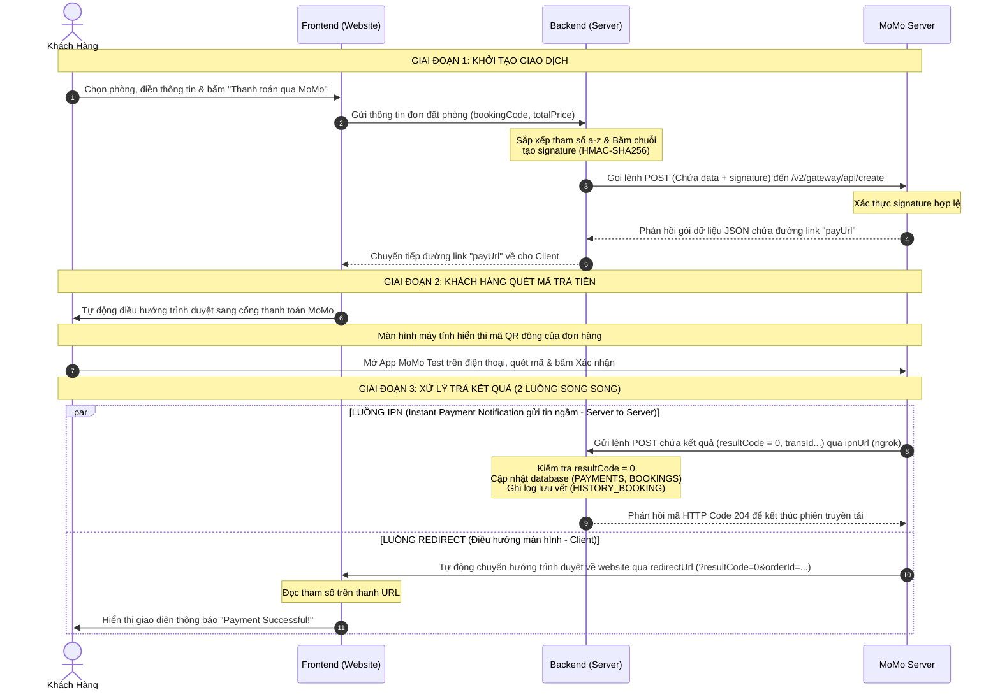

# final-assignment

# 📑 TÀI LIỆU TÍCH HỢP THANH TOÁN MOMO (SANDBOX) — HỆ THỐNG ĐẶT PHÒNG KHÁCH SẠN

> **Phương thức:** `captureWallet`
> **Database:** MySQL (schema đính kèm bên dưới)
> **Stack tham khảo:** Node.js + Express (áp dụng tương tự cho bất kỳ backend nào — Java, PHP, .NET...)

---

## 📌 MỤC LỤC

1. [Sơ đồ tổng quan luồng](#1-sơ-đồ-tổng-quan-luồng)
2. [Cấu trúc Database liên quan](#2-cấu-trúc-database-liên-quan)
3. [Chuẩn bị môi trường & thông tin cấu hình](#3-chuẩn-bị-môi-trường--thông-tin-cấu-hình)
4. [Implementation chi tiết từng bước](#4-implementation-chi-tiết-từng-bước)
5. [Bảng tổng hợp Docs tham khảo](#5-bảng-tổng-hợp-docs-tham-khảo)
6. [Checklist kiểm thử](#6-checklist-kiểm-thử)

---

## SƠ ĐỒ TỔNG QUAN LUỒNG CHẠY HỆ THỐNG


---

## 2. CẤU TRÚC DATABASE LIÊN QUAN

```sql
CREATE TABLE BOOKINGS (
  id VARCHAR(36) PRIMARY KEY,
  booking_code VARCHAR(50) UNIQUE,
  user_id VARCHAR(36),
  room_id VARCHAR(36),
  check_in DATE,
  check_out DATE,
  guest_count INT,
  guest_name VARCHAR(255),
  guest_email VARCHAR(255),
  guest_phone VARCHAR(20),
  special_requests TEXT,
  total_price DECIMAL(15,2),
  status ENUM('Pending', 'Confirmed', 'Completed', 'Cancelled') DEFAULT 'Pending',
  create_at TIMESTAMP DEFAULT CURRENT_TIMESTAMP,
  FOREIGN KEY (user_id) REFERENCES USERS(id) ON DELETE SET NULL,
  FOREIGN KEY (room_id) REFERENCES ROOMS(id) ON DELETE SET NULL
);

CREATE TABLE PAYMENTS (
  id VARCHAR(36) PRIMARY KEY,
  booking_id VARCHAR(36) UNIQUE,
  payment_method VARCHAR(50),
  transaction_id VARCHAR(255) UNIQUE,
  momo_order_id VARCHAR(150) UNIQUE;  -- Cột này để tra cứu chính xác khi MoMo gửi IPN về (vì orderId gửi lên MoMo sẽ khác booking_code, xem lý do ở mục 3)
  amount DECIMAL(15,2),
  status ENUM('Pending', 'Completed', 'Failed', 'Refunded') DEFAULT 'Pending',
  paid_at TIMESTAMP NULL DEFAULT NULL,
  FOREIGN KEY (booking_id) REFERENCES BOOKINGS(id) ON DELETE CASCADE
);

CREATE TABLE HISTORY_BOOKING (
  id VARCHAR(36) PRIMARY KEY,
  booking_id VARCHAR(36),
  action VARCHAR(100),
  note TEXT,
  created_at TIMESTAMP DEFAULT CURRENT_TIMESTAMP,
  FOREIGN KEY (booking_id) REFERENCES BOOKINGS(id) ON DELETE CASCADE
);
```

---

## MoMo Payment Flow — Full Explanation
There are 5 files involved. Here's the exact order they activate:

📁 File Activation Order
1. momo-config.php        ← loaded by everything (config only)
2. booking-modal.js       ← user triggers payment
3. create_booking.php     ← creates booking + gets MoMo link
4. momo_ipn.php           ← MoMo confirms payment (server→server)
5. momo_return.php        ← user lands here after paying
Step-by-step breakdown
1. User clicks "Thanh toán với MoMo" → 

### booking-modal.js
1. runs in the browser

```
User fills form → clicks button
→ JS collects: room_id, check_in, check_out, guest_name, email, phone
→ JS sends POST fetch() to → api/create_booking.php
```

2. create_booking.php runs on your PHP server → 

### api/create_booking.php

    1. Validates dates, room availability
    2. Calculates price (nights × price + 10% tax)
    3. Inserts BOOKING row  → status = "Pending"
    4. Inserts PAYMENT row  → status = "Pending"
    5. Loads momo-config.php (credentials, URLs)
    6. Builds HMAC-SHA256 signature
    7. Sends POST request → MoMo sandbox API
    8. MoMo returns { payUrl: "https://test-payment.momo.vn/..." }
    9. Returns { success: true, payUrl } → back to JS

3. booking-modal.js receives payUrl

### data.payUrl received
```
→ window.location.href = data.payUrl
→ Browser redirects user to MoMo's payment page
```

4. User pays on MoMo's page MoMo fires two responses simultaneously:
```
┌─────────────────────────────────┐   ┌──────────────────────────────────┐
│  IPN (server → server)          │   │  Redirect (browser → your site)  │
│  MoMo calls your ngrok URL      │   │  MoMo sends user back to you     │
│  → api/momo_ipn.php             │   │  → momo_return.php               │
└─────────────────────────────────┘   └──────────────────────────────────┘
```
5. momo_ipn.php — the authoritative DB update → 

api/momo_ipn.php

MoMo sends JSON payload (in background, not visible to user):
{
  orderId, resultCode, transId, amount, signature...
}
    1. Verifies HMAC-SHA256 signature  ← security check
    2. Finds PAYMENT row by momo_order_id
    3. Checks idempotency (already processed? → skip)
    4. If resultCode === 0 (success):
        BOOKINGS.status  → "Confirmed"
        PAYMENTS.status  → "Completed"
        PAYMENTS.transaction_id → MoMo's transId
        HISTORY_BOOKING  → log "PAYMENT_CONFIRMED"
    5. If resultCode ≠ 0 (failed/cancelled):
        BOOKINGS.status  → "Cancelled"
        PAYMENTS.status  → "Failed"
    6. Always returns HTTP 200 (MoMo requires this)
6. momo_return.php — what the user sees → 

    momo_return.php

    MoMo redirects browser with query params:
    ?orderId=...&resultCode=0&transId=...&signature=...
    1. Verifies HMAC-SHA256 signature
    2. Looks up BOOKING + PAYMENT from DB by orderId
    3. resultCode === 0 → shows ✅ success card with booking details
    4. resultCode ≠ 0   → shows ❌ failure card with error message
    Why IPN + Return page both exist?
    IPN (momo_ipn.php)	Return page (momo_return.php)
    Who calls it	MoMo's servers	User's browser
    Purpose	Update the database	Show UI to user
    Reliability	✅ Always fires, even if user closes browser	❌ Fails if user closes tab
    Trusted for DB	✅ Yes	⚠️ No — display only
    IMPORTANT

    The IPN is the source of truth. The return page just shows a UI — it reads from the DB that IPN already updated. Never update DB status based only on return page params.