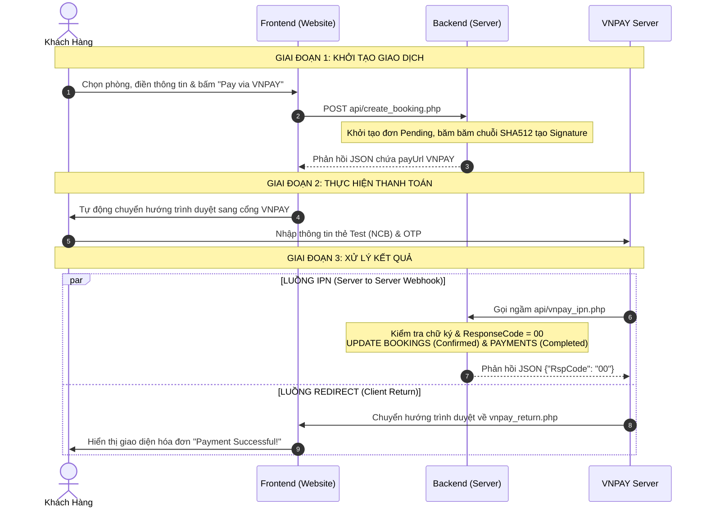

# Ocean Haven Hotel — Hệ thống Đặt phòng Khách sạn

Đây là dự án Website Đặt phòng Khách sạn (Ocean Haven Hotel), cung cấp đầy đủ các tính năng cho phía người dùng cuối (tìm kiếm, lọc, đặt phòng, thanh toán trực tuyến qua VNPAY) và trang Quản trị (Dashboard thống kê, kiểm tra nhận phòng).

Dự án được xây dựng dựa trên kiến trúc **PHP thuần (Vanilla PHP) kết hợp MySQL** ở phía Backend và **ES6 Modules JavaScript, CSS Component-based** ở phía Frontend.

---

## 📌 MỤC LỤC
1. [Cấu trúc Thư mục Tổng quan](#1-cấu-trúc-thư-mục-tổng-quan)
2. [Chi tiết Chức năng & Mối liên kết các File](#2-chi-tiết-chức-năng--mối-liên-kết-các-file)
3. [Luồng Kiến trúc Frontend (ES6 Modules & CSS Modular)](#3-luồng-kiến-trúc-frontend-es6-modules--css-modular)
4. [Luồng Xử lý Upload Avatar](#4-luồng-xử-lý-upload-avatar)
5. [Luồng Xử lý Thanh toán (VNPAY)](#5-luồng-xử-lý-thanh-toán-vnpay)
6. [Cấu trúc Database](#6-cấu-trúc-database)
7. [Giải thích Các Tính năng Chính](#7-giải-thích-các-tính-năng-chính-key-features-explanation)
8. [Thách thức và Giải pháp](#8-thách-thức-và-giải-pháp-challenges--solutions)
9. [Tài liệu Tích hợp Thanh toán VNPAY (Sandbox)](#9-tài-liệu-tích-hợp-thanh-toán-vnpay-sandbox)

---

## 1. CẤU TRÚC THƯ MỤC TỔNG QUAN

```text
final_assignment/
├── admin/                  # Khu vực quản trị (Chỉ dành cho tài khoản Admin)
│   ├── index.php           # File giao diện chính, include các partials
│   ├── dashboard-data.php  # Xử lý truy vấn CSDL (Model) cho Admin
│   └── partials/           # Chứa các component giao diện nhỏ
├── api/                    # Chứa các endpoint API chia theo domain
│   ├── users/              # Gồm: upload_avatar.php, get_profile.php, update_profile.php
│   ├── rooms/              # Gồm: get_rooms.php
│   ├── bookings/           # Gồm: create_booking.php, booking-validation.php, booking-data.php, cancel_booking.php...
│   └── payments/           # Gồm: vnpay_ipn.php, vnpay-signature.php
├── assets/                 # Các tài nguyên tĩnh (CSS, JS)
│   ├── css/                # Đã chia nhỏ thành components/ và pages/
│   └── js/                 # Viết theo chuẩn ES6 Modules (import / export)
│       ├── main.js         # Module chính nạp Navbar, Auth modals và Avatar state
│       ├── global.js       # Module API layer cung cấp HotelDb
│       ├── navbar.js       # Module điều khiển thanh điều hướng & avatar
│       ├── search-bar.js   # Module thanh tìm kiếm ngày check-in/check-out
│       ├── profile/        # Module hồ sơ (upload_avatar.js, profile-modal.js, templates)
│       ├── booking/        # Module đặt phòng (booking-modal.js, templates)
│       ├── rooms/          # Module danh mục phòng (rooms.js, templates)
│       └── detail/         # Module chi tiết phòng (detail.js, templates)
├── auth/                   # Xử lý phiên làm việc (session.php), Đăng nhập, Đăng ký, Đăng xuất
├── config/                 # Các file cấu hình Database (db-connection.php) và VNPAY (vnpay-config.php)
├── database/               # File db.sql định nghĩa cấu trúc bảng CSDL MySQL và dữ liệu mẫu
├── public/                 # Chứa tài nguyên lưu trữ tĩnh của ứng dụng
│   └── images/             # Thư mục lưu trữ tệp ảnh Avatar tải lên thực tế
├── template/               # Giao diện dùng chung (Header, Footer, Navbar...)
├── home.php                # Trang chủ khách sạn
├── rooms.php               # Trang danh sách toàn bộ phòng (có bộ lọc và phân trang)
├── detail.php              # Trang chi tiết 1 phòng cụ thể
└── vnpay_return.php        # Trang hiển thị kết quả sau thanh toán VNPAY
```

---

## 2. CHI TIẾT CHỨC NĂNG & MỐI LIÊN KẾT CÁC FILE

### Giao diện Người dùng (Frontend PHP Pages)
Các file này đại diện cho các trang mà người dùng truy cập trực tiếp. Tất cả đều tuân theo nguyên tắc: Include `header/index.php` ở trên cùng và `template/footer.php` ở dưới cùng.
- **`home.php`**: Hiển thị trang chủ với Hero section và danh sách phòng nổi bật.
- **`rooms.php`**: Trang "Tất cả phòng", cung cấp giao diện sidebar bộ lọc (loại phòng, tầng, hướng nhìn, giá, sức chứa), tìm kiếm từ khóa và phân trang (pagination).
- **`detail.php`**: Trang chi tiết phòng. Hiển thị thư viện ảnh (gallery), danh sách tiện ích và widget đặt phòng (Sticky Booking Widget).

### API Endpoints (`/api/`)
Đóng vai trò cầu nối Backend (JSON) cho Frontend, được chia nhỏ theo domain:
- **`users/`**: Chứa `upload_avatar.php` (lưu file vật lý và cập nhật URL vào DB), `get_profile.php` và `update_profile.php`.
- **`rooms/`**: Chứa `get_rooms.php` (Lấy danh sách phòng, tiện nghi và logic lọc phòng trống).
- **`bookings/`**:
  - `create_booking.php` (Orchestrator): Kết nối quy trình validation, insert CSDL và tạo link thanh toán.
  - `booking-validation.php`: Chịu trách nhiệm kiểm tra dữ liệu đầu vào.
  - `booking-data.php`: Mở Database Transaction, chèn dữ liệu Đơn phòng, Thanh toán, Lịch sử và bắt an toàn lỗi Trigger từ cơ sở dữ liệu.
  - `get_bookings.php` / `cancel_booking.php` / `update_booking_status.php`: Quản lý thao tác danh sách đơn.
- **`payments/`**:
  - `vnpay-signature.php`: File core chứa hàm tái sử dụng `buildVnpayUrl()` (băm HMAC-SHA512).
  - `vnpay_ipn.php`: Webhook IPN xử lý kết quả ngầm (Server-to-Server) từ VNPAY.

### Khu vực Quản trị (`/admin/`)
- Cấu trúc Admin Dashboard được Refactor theo mô hình MVC thu gọn:
  - **`index.php`**: Tệp view chính.
  - **`dashboard-data.php`**: Xử lý toàn bộ logic truy vấn (Queries) để lấy số liệu thống kê.
  - **`partials/`**: Tách nhỏ giao diện thành `_stats-cards.php`, `_search-panel.php`, `_checkins-table.php` và `_bookings-row.php` giúp code sạch và dễ bảo trì.
  - Cho phép thao tác Check-out, Hủy đơn bằng Ajax (thông qua `assets/js/admin-dashboard.js`).

### Giao diện dùng chung (`/template/`)
- **`header/index.php`**: Khai báo thẻ `<head>`, SEO meta tags, load CSS toàn cục (global, navbar, footer, modals) và include `navbar.php`, `login-modal.php`, `register-modal.php`.
- **`footer.php`**: Hiển thị chân trang và quản lý việc chèn thẻ `<script type="module">`. Nạp entry point `main.js` và các trang modules theo nhu cầu qua mảng `$pageScripts` / `$pageScript`.

---

## 3. LUỒNG KIẾN TRÚC FRONTEND (ES6 MODULES & CSS MODULAR)

Hệ thống Frontend sử dụng chuẩn **ES6 Modules (`import` / `export`)** để tối ưu hiệu suất và dễ bảo trì:

### Kiến trúc JavaScript (`assets/js/`)
Mọi Component đều được chia thành các module ES6 chuyên biệt:
1. **Tệp Templates (`*.templates.js`)**: Sinh ra chuỗi HTML. Không thao tác DOM, không gán sự kiện trực tiếp.
2. **Tệp Controllers (`*.js`)**: Gọi API (thông qua `global.js`), gán dữ liệu vào Templates, chèn vào DOM và bắt sự kiện click/submit.

**Các modules nổi bật:**
- **`main.js`**: Central ES6 Entry point module nạp chung trên `footer.php`. Tự động khởi tạo Navbar, Auth modals và tải `avatar_url` từ CSDL hiển thị lên Navbar.
- **`profile/upload_avatar.js`**: Module chịu trách nhiệm xử lý sự kiện tải ảnh đại diện từ client, gửi `FormData` lên API `upload_avatar.php` và cập nhật ảnh ngay tức thì trên giao diện.
- **`profile/profile-modal.js`**: Quản lý Modal hồ sơ cá nhân (thông tin user, lịch sử đặt phòng).
- **`booking/booking-modal.js`**: Quản lý đa bước (Multi-step) modal đặt phòng (Tính toán giá theo đêm, thuế, gọi API VNPAY).
- **`rooms/rooms.js` & `detail/detail.js`**: Quản lý logic bộ lọc phòng, phân trang và gallery xem ảnh chi tiết.
- **`global.js`**: Cung cấp object `HotelDb` làm lớp giao tiếp trung tâm (API Layer) với Backend.

### Kiến trúc CSS (`assets/css/`)
File CSS đã được chia nhỏ theo mô hình Component-based:
- **`global.css`**: Chứa CSS Variables, reset layout, typography và các class button/badge dùng chung.
- **`components/`**: Các file CSS cho từng thành phần giao diện nhỏ (`navbar.css`, `footer.css`, `search-bar.css`, `room-card.css`, `modals.css`).
- **`pages/`**: Các layout lớn dành riêng cho từng trang (`home.css`, `rooms.css`, `detail.css`).

---

## 4. LUỒNG XỬ LÝ UPLOAD AVATAR

Hệ thống upload avatar đã được chuyển đổi hoàn toàn sang cơ chế lưu trữ tập tin thực tế trên Server và CSDL:

```
[Khách hàng chọn file ảnh trên Modal Profile]
                       ↓
upload_avatar.js (Gửi FormData chứa $_FILES['avatar'])
                       ↓
API: api/upload_avatar.php
   ├── 1. Kiểm tra session đăng nhập
   ├── 2. Kiểm tra định dạng (JPG, PNG, GIF, WEBP) & dung lượng (<= 5MB)
   ├── 3. Lưu/Copy file thực tế vào thư mục public/images/avatar_{user_id}_{timestamp}.ext
   └── 4. Cập nhật URL (/ocean_haven/public/images/...) vào cột `avatar` bảng `USERS` trong MySQL
                       ↓
Trả về JSON { success: true, avatar_url: "..." }
                       ↓
Frontend tự động cập nhật ảnh mới trên Modal Profile & thanh Navbar
```

---

## 5. LUỒNG XỬ LÝ THANH TOÁN (VNPAY)

Hệ thống được thiết kế với **2 luồng song song** khi nhận phản hồi từ cổng thanh toán VNPAY:

1. **Luồng Giao diện (Client Redirect): `vnpay_return.php`**
   - Trình duyệt của khách hàng bị điều hướng về trang này sau khi thực hiện thanh toán.
   - Kiểm tra chữ ký (Hash HMAC-SHA512), hiển thị thẻ báo cáo hóa đơn Thành công/Thất bại.
   - Dùng để phục vụ trải nghiệm người dùng (UX).

2. **Luồng Cập nhật ngầm (IPN Server-to-Server): `api/vnpay_ipn.php`**
   - Server VNPAY trực tiếp gọi ngầm tới webhook của hệ thống.
   - Kiểm tra chữ ký hợp lệ -> **Trực tiếp cập nhật bảng BOOKINGS và PAYMENTS** trong CSDL (`Confirmed` hoặc `Cancelled`).
   - Phản hồi mã JSON `{"RspCode": "00"}` để VNPAY xác nhận giao dịch thành công.

---

## 6. CẤU TRÚC DATABASE

- **`USERS`**: Lưu thông tin người dùng (`id`, `name`, `email`, `phone`, `role`, `avatar`, `password_hash`, `create_at`). Cột `avatar` lưu đường dẫn tập tin ảnh đại diện trong `public/images/`.
- **`ROOM_TYPES` / `VIEW_TYPES` / `BED_TYPES`**: Các bảng danh mục giúp chuẩn hóa dữ liệu phòng, tránh lỗi typo.
- **`ROOMS`**: Danh mục phòng, sức chứa, giá tiền, rating, số tầng, tiện nghi và mô tả.
- **`ROOM_IMAGES` / `ROOM_AMENITIES`**: Quan hệ 1-nhiều lưu trữ thư viện ảnh và danh sách tiện ích của từng phòng.
- **`BOOKINGS`**: Dữ liệu hóa đơn đặt phòng. Quan hệ với USERS và ROOMS. Trạng thái (`Pending`, `Confirmed`, `Cancelled`). Có thời hạn giữ chỗ `hold_expires_at`.
- **`PAYMENTS`**: Giao dịch thanh toán cụ thể. Lưu `vnpay_order_id` và `transaction_id` để đối soát với VNPAY.
- **`HISTORY_BOOKING`**: Bảng ghi log các thao tác (tạo đơn, thanh toán thành công, hủy phòng) dùng để truy vết hệ thống.

---

## 7. GIẢI THÍCH CÁC TÍNH NĂNG CHÍNH (KEY FEATURES EXPLANATION)

### 7.1. Thuật toán xử lý Đặt phòng và Lọc theo ngày (Date Search & Overlapping Logic)
Một trong những tính năng cốt lõi của hệ thống đặt phòng là **hiển thị phòng trống theo ngày** và **tránh trùng lặp ngày** (double-booking).
Khi một phòng đã được đặt trong một khoảng thời gian, phòng đó sẽ không xuất hiện ở trang tìm kiếm trong khoảng thời gian đó, nhưng vẫn hoàn toàn khả dụng ở các khoảng thời gian khác.

**Ví dụ logic thực tế**:
- Khách hàng A đặt Phòng 001 từ ngày `01/10` đến `05/10`.
- Nếu Khách hàng B tìm kiếm phòng từ ngày `03/10` đến `06/10`, Phòng 001 sẽ **không hiển thị** vì khoảng thời gian tìm kiếm cắt ngang (overlap) với lịch đã đặt.
- Nếu Khách hàng B tìm kiếm từ ngày `05/10` đến `10/10`, Phòng 001 **vẫn hiển thị bình thường** (vì ngày check-out của A trùng ngày check-in của B là hợp lệ).

**Triển khai kỹ thuật (Implementation Details):**
Bài toán này được giải quyết ở 2 chốt chặn:

1. **Chốt chặn 1: Tính năng Date Search (Tải phòng trống)**
   Tại file `api/get_rooms.php` (Từ **dòng 65 đến 72**):
   ```sql
   AND r.id NOT IN (
       SELECT b.room_id FROM BOOKINGS b
       WHERE b.status != 'Cancelled'
         AND b.check_in < '$check_out'
         AND b.check_out > '$check_in'
   )
   ```
   Điều kiện `b.check_in < $check_out AND b.check_out > $check_in` là công thức chuẩn để kiểm tra 2 khoảng thời gian có cắt nhau hay không.

2. **Chốt chặn 2: Chống Trùng lặp & Race Condition (Database Level Prevention)**
   Khi hàng ngàn request cùng đặt 1 phòng trong một mili-giây, việc chỉ dùng code PHP để check là không đủ (Race Condition).
   - MySQL đã được cài đặt **Trigger `before_booking_insert`**. 
   - Ngay khoảnh khắc chuẩn bị `INSERT` xuống bảng `BOOKINGS`, Trigger ở cấp độ Database sẽ đếm overlap. Nếu phát hiện trùng, MySQL sẽ chủ động đá request ra bằng mã lỗi `SIGNAL SQLSTATE '45000'`.
   - Tại `api/bookings/booking-data.php`, mã PHP bọc thao tác `INSERT` trong một khối `mysqli_begin_transaction()`. Nếu bắt được mã lỗi `45000`, PHP sẽ thực thi `ROLLBACK` một cách gọn gàng và trả về cảnh báo an toàn cho User mà không làm sập server hay hỏng database.

### 7.2. Cơ chế giữ chỗ (Booking Hold)
Khi khách hàng bấm "Thanh toán", họ sẽ được chuyển hướng sang cổng VNPAY. Trong thời gian chờ khách hoàn tất nhập OTP:
- Hệ thống lưu trạng thái đơn hàng là `Pending` và thời điểm hết hạn `hold_expires_at = CURRENT_TIME + 15 phút`.
- Nếu quá 15 phút mà không nhận được IPN từ VNPAY, đơn phòng giữ chỗ sẽ tự động bị loại bỏ khỏi lịch bận.

---

## 8. THÁCH THỨC VÀ GIẢI PHÁP (CHALLENGES & SOLUTIONS)

### 8.1. Chuyển đổi Frontend sang ES6 Modules
- **Vấn đề**: Việc nạp các thẻ `<script>` theo chuẩn cũ khiến phạm vi biến tràn vào `window` toàn cục, dễ gây xung đột tên hàm giữa các trang.
- **Giải pháp**: Đưa toàn bộ các file JS trong `assets/js/` về chuẩn **ES6 Modules** (`import` / `export`). Sử dụng file `main.js` làm Entry point trung tâm và nạp qua thẻ `<script type="module">` tại `footer.php`.

### 8.2. Upload Avatar thực tế và Lưu CSDL
- **Vấn đề**: Việc lưu tạm ảnh bằng `localStorage` trước đây gây ngốn bộ nhớ trình duyệt và không thể đồng bộ khi người dùng đăng nhập ở thiết bị khác.
- **Giải pháp**: Xây dựng API `api/upload_avatar.php` lưu file ảnh trực tiếp vào thư mục `public/images/`, lưu đường dẫn URL vào cột `USERS.avatar` trong MySQL và đồng bộ ảnh đại diện trên toàn bộ giao diện từ CSDL.

---

## 9. TÀI LIỆU TÍCH HỢP THANH TOÁN VNPAY (SANDBOX)

> **Phương thức:** Chuyển hướng thanh toán qua VNPAY Gateway
> **Mã hóa:** HMAC-SHA512

### SƠ ĐỒ TỔNG QUAN LUỒNG CHẠY HỆ THỐNG


### VNPAY Sandbox Test Credentials
Sử dụng thẻ thử nghiệm sau để test thanh toán tại cổng Sandbox NCB:

| Trường dữ liệu | Giá trị Test |
|-------|-------|
| Ngân hàng | `NCB` |
| Số thẻ | `9704198526191432198` |
| Tên in trên thẻ | `NGUYEN VAN A` |
| Ngày phát hành | `07/15` |
| Mật khẩu OTP | `123456` |
