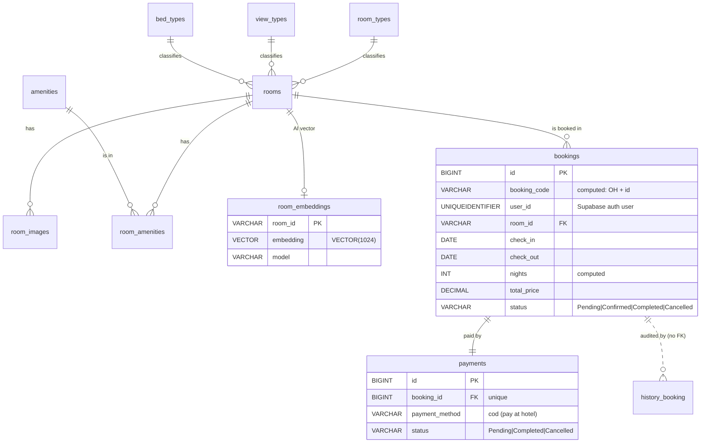
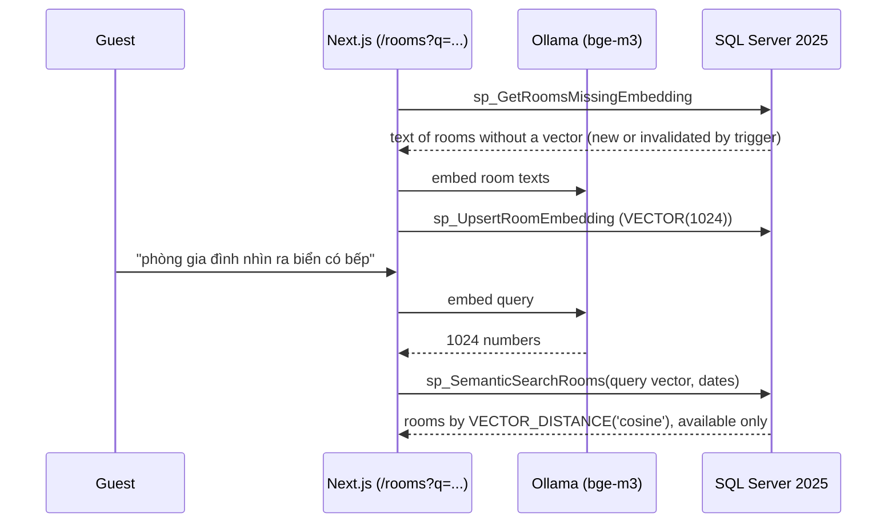

# Ocean Haven — SQL Server database design

The booking platform uses a **hybrid** data layer:

| Concern | Where | Why |
| :--- | :--- | :--- |
| Login, sessions, user profile & role | **Supabase** (Auth + `public.users`) | Secure cookie-based auth out of the box |
| Rooms, bookings, payments, booking history, AI embeddings | **SQL Server 2025 Developer** (`OceanHaven` database) | Business logic in stored procedures, triggers, indexes, native `VECTOR` type |

The Next.js app never writes SQL Server tables directly: every read and write goes through a
stored procedure (`execProc()` in `src/shared/lib/db/sqlserver.ts`).



## Setup

Requirements: Docker (or a local SQL Server 2025 Developer install) and [Ollama](https://ollama.com).

```bash
# 1. Add to .env.local
MSSQL_HOST=localhost
MSSQL_PORT=1433
MSSQL_USER=sa
MSSQL_PASSWORD=OceanHaven@2026     # must satisfy SQL Server password complexity
MSSQL_DATABASE=OceanHaven
OLLAMA_URL=http://localhost:11434
EMBEDDING_MODEL=bge-m3

# 2. Start SQL Server 2025 Developer in Docker (Apple Silicon: enable Rosetta in Docker/Colima)
npm run db:start

# 3. Create tables, indexes, functions, triggers, procedures and seed data
npm run db:setup          # drops and recreates all tables

# 4. Run the database tests (22 checks of procedures, transactions and triggers)
npm run db:test

# 5. Embedding model for AI search
ollama pull bge-m3

# Optional: measure the indexes on 50,600 generated bookings (rolled back afterwards)
npm run db:run -- tests/index_demo.sql
```

The `.sql` files are plain T-SQL separated by `GO`, so they can also be opened and run in order in
SSMS or Azure Data Studio.

| File | Content |
| :--- | :--- |
| `01_schema.sql` | Database, tables, constraints, computed columns |
| `02_indexes.sql` | Nonclustered indexes, each with the query it serves |
| `03_functions.sql` | `fn_BlockingBookings`, the single definition of "room is occupied" |
| `04_triggers.sql` | 4 triggers |
| `05_procedures.sql` | Business-logic and read procedures |
| `06_semantic_search.sql` | AI semantic search procedures |
| `07_seed.sql` | 22 rooms, images, amenities |
| `tests/test_business_logic.sql` | Assertion tests (`npm run db:test`) |
| `tests/index_demo.sql` | Index before/after measurement |

---

## 1. Stored procedures with transactions

| Procedure | Called from | What it does in ONE transaction |
| :--- | :--- | :--- |
| `sp_CreateBooking` | Booking form (`createBooking` action) | Validates dates/guests → **locks the room row** → checks availability → computes price from DB → inserts booking **and** payment |
| `sp_UpdateBookingStatus` | Admin dashboard | Enforces allowed transitions → updates booking → keeps payment consistent (`Cancelled` on cancel, cash collected on complete) |
| `sp_GetRooms`, `sp_GetUserBookings`, `sp_GetAdminBookings`, `sp_GetAdminStats` | Pages | Read models (rooms as nested JSON in one round trip, stats in one pass) |
| `sp_GetRoomsMissingEmbedding`, `sp_UpsertRoomEmbedding`, `sp_SemanticSearchRooms` | AI search | See section 4 |

Every write procedure uses the same pattern:

```sql
SET XACT_ABORT ON;              -- any runtime error dooms the transaction
BEGIN TRY
    BEGIN TRANSACTION;
    ...                         -- several statements that must succeed together
    COMMIT TRANSACTION;
END TRY
BEGIN CATCH
    IF @@TRANCOUNT > 0 ROLLBACK TRANSACTION;   -- undo everything
    THROW;                                     -- re-raise to the app
END CATCH;
```

Business-rule violations are raised with `THROW 500xx, N'<message for the user>'`. The app shows
the message of errors 50000–50999 (`src/shared/lib/db/errors.ts`) and hides all other errors behind
a generic message.

**Why a transaction matters here:** a booking without its payment row, or a completed stay whose
cash payment is not marked as collected, would leave the data inconsistent. Inside one
transaction, either everything is written or nothing is (verified by the test
*"rejected booking rolled back completely (no orphan rows)"*).

**Concurrency (double-booking race):** checking availability and then inserting is a classic race:
two guests can both see the room as free. `sp_CreateBooking` reads the room with
`WITH (UPDLOCK, ROWLOCK)`, so a second booking for the *same* room waits until the first commits
and then sees the new booking. Bookings for other rooms are not blocked. Measured: **10 concurrent
calls** for the same room and dates → **1 succeeds, 9 fail with error 50010**, no deadlocks.

## 2. Triggers

SQL Server triggers fire **once per statement**; the virtual tables `inserted` (new rows) and
`deleted` (old rows) contain every affected row, so all triggers are written set-based.

| Trigger | Event | Action |
| :--- | :--- | :--- |
| `trg_bookings_audit` | `AFTER INSERT, UPDATE, DELETE` on `bookings` | Writes `CREATED` / `STATUS_CHANGE` (old → new) / `DELETED` rows to `history_booking`, whoever made the change |
| `trg_bookings_prevent_overlap` | `AFTER INSERT, UPDATE` on `bookings` | `THROW 50010` and roll back if the row would double-book a room, even for writes that bypass `sp_CreateBooking` (manual SQL, a script reviving a cancelled booking whose dates were taken meanwhile) |
| `trg_rooms_invalidate_embedding` | `AFTER UPDATE` on `rooms` | When name/description/type/view/beds/capacity change, deletes the room's AI vector (now stale) and stamps `updated_at` |
| `trg_room_amenities_invalidate_embedding` | `AFTER INSERT, DELETE` on `room_amenities` | Amenities are part of the embedded text, so changes also invalidate the vector |

`history_booking` intentionally has **no foreign key** to `bookings`: an audit record must survive
the deletion of the booking it describes.

## 3. Indexes and how they speed up queries

Every `PRIMARY KEY` is the **clustered index** (the table itself, stored as a B-tree sorted by the
key). `bookings.id` is a `BIGINT IDENTITY`: narrow and ever-increasing, so new rows are always
appended at the end of the B-tree (no page splits). The nonclustered indexes below are separate,
smaller B-trees that point back to the clustered index.

| Index | Query it serves | Technique |
| :--- | :--- | :--- |
| `IX_bookings_active_room_dates` (room_id, check_in) INCLUDE (check_out) WHERE status IN ('Pending','Confirmed') | Availability / overlap check (booking, room list, AI search, trigger) | **Composite** key for seek on room + range on date, **INCLUDE** so no lookup, **filtered** so cancelled/completed history is not in the index |
| `UX_bookings_booking_code` | Unique booking codes, lookup by code | **Unique** index on a **persisted computed column** |
| `IX_bookings_user_created` (user_id, created_at DESC) | "My bookings", newest first | Equality column first, sort column second → no SORT operator |
| `IX_bookings_guest_phone` | Admin phone search `LIKE '0912%'` | Prefix `LIKE` is **SARGable** (becomes a range seek) |
| `IX_payments_status` (status) INCLUDE (amount) | Revenue `SUM(amount)` | **Covering** index |
| `IX_room_images_room`, `IX_room_amenities_amenity`, `IX_history_booking_booking` | Joins from parent rows, cascading deletes | SQL Server does **not** index foreign keys automatically |

**Measured** with `tests/index_demo.sql`: 50,600 bookings, `SET STATISTICS IO ON`, logical reads =
8 KB pages read. "Without" forces a scan of the clustered index.

| Query | With index | Without | Reduction |
| :--- | ---: | ---: | ---: |
| Availability check for one room | **3** pages | 1,132 pages | ~377× |
| My bookings, newest first | **3** | 1,132 (+ sort) | ~377× |
| Admin phone search, prefix `'0912%'` | **5** | 178 (`'%0912%'`, full index scan) | ~36× |
| Lookup by booking code | **2** | 1,132 | ~566× |
| Revenue `SUM(amount)` | **206** | 367 | ~1.8× (covering index is narrower, but every completed payment must still be summed) |

With only 22 rooms and a few bookings the optimizer may still choose a scan, because reading one page
is cheaper than navigating an index. Indexes pay off as the bookings table grows, and the demo shows
that growth.

Two more query-design points used in the procedures:

- `OPTION (RECOMPILE)` on the optional-filter queries (`@x IS NULL OR col = @x`): without it SQL
  Server caches one plan for all filter combinations; recompiling lets it seek when a filter is given.
- `fn_BlockingBookings` is an **inline** table-valued function, so the optimizer expands it into
  the calling query like a view and plans it together with it (seek on
  `IX_bookings_active_room_dates`). A multi-statement function would run as a separate black box
  with a fixed row estimate.

## 4. AI integration: semantic room search

Guests type what they want in their own words, in **English or Vietnamese**, and press Enter in the
search box on `/rooms` (✨ button). Rooms are ranked by meaning, not by keywords, and each card shows
a "% match" badge.



- **Model**: `bge-m3` via local Ollama: free, offline, multilingual, 1024 dimensions.
- **Storage**: `room_embeddings.embedding VECTOR(1024)`, SQL Server 2025's native vector type.
  The app sends `"[0.12, -0.03, …]"` and `CAST(@x AS VECTOR(1024))` validates the length.
- **Search**: `VECTOR_DISTANCE('cosine', e.embedding, @Query)`, similarity = 1 − distance, combined
  in the same query with relational filters (active room, `fn_BlockingBookings` availability).
  This is a **hybrid query** that a standalone vector database could not express as easily.
- **Relevance cutoff** `@MinSimilarity = 0.45`, chosen from measurements on the real data:

  | Query | Top result (similarity) |
  | :--- | :--- |
  | "romantic room for a couple with a bathtub" | Sunset Deluxe (0.58) |
  | "phòng gia đình nhìn ra biển có bếp" (family, sea view, kitchen) | Sunrise Suite (0.67), Seaside Family Suite (0.67), Ocean Haven Suite (0.64) |
  | "chỗ cho trẻ em chơi" (somewhere for kids to play) | Family Garden Suite (0.48), Ocean Haven Suite (0.47) |
  | "pizza delivery" | best 0.42 → no results |
  | "asdfgh qwerty" | best 0.34 → no results |

- **Freshness**: the two embedding triggers delete stale vectors; the next search re-embeds them.
- **Fallback**: if Ollama is not running, `/rooms` shows a notice and falls back to keyword filtering.
- **Why no vector index**: exact search over 22 vectors takes under a millisecond and is 100%
  accurate. SQL Server 2025's approximate DiskANN index (`CREATE VECTOR INDEX` + `VECTOR_SEARCH`)
  is meant for tens of thousands of vectors and above.

## Known limitations (acceptable for this assignment)

- `bookings.user_id` cannot have a foreign key to Supabase's `users` table (different database).
- Payment is at the hotel only (no online gateway), so a booking holds the room from the moment it
  is created until an admin cancels it; there is no automatic expiry of unpaid bookings.
- Admin phone search matches from the start of the number (prefix), so it can use the index.
